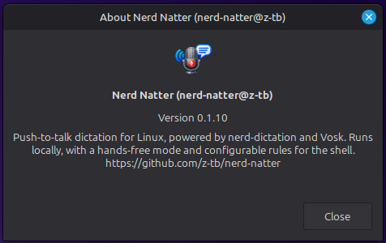
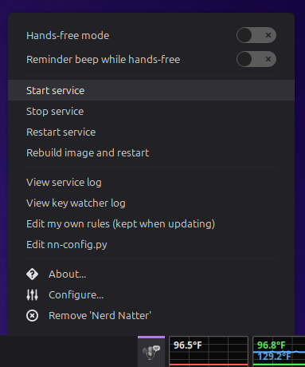

# Nerd Natter

This is a Push-to-talk Cinnamon desktop applet that works with the voice-to-text nerd-dication project. Hold a key down to talk, and words are typed wherever your
cursor is: a terminal, a browser, an editor, anything. Let go and it stops listening, so your microphone stays free for everything else like Zoom or whatever.

Since it's involved with running commands on my system, I prefer to run in in a docker container with no network access. This gives better control over isolation, especially if the same system running ND is also running AI models or other AI enabled applications. Obviosly, you'll need docker installed to use this feature. 

Speaking of AI, this project started out as a collection of shell scripts and a Makefile. These worked well but when I started thinking about a push-to-talk feature, the cinnamon applet made a lot more sense. I loaded up the Makefile, shell scripts and source code into claude, and over the course of a couple of weekends, had a pretty functional cinnamon applet that I use pretty much daily now. I'm still working out better shell capability since the symbols and other cli incantations require literal characters and not the spoken words. I'm mentioning this because i think it's responsible disclosure. I do my best to review generated code, but clankers sometimes implement things in ridiculous ways in unexpected places.

Nerd Natter is a wrapper around two free programs:

- [nerd-dictation](https://github.com/ideasman42/nerd-dictation) does the typing.
- [Vosk](https://alphacephei.com/vosk) understands your voice. It runs entirely on your own
  computer, and nothing is sent anywhere.

On top of them it adds the push-to-talk key (default is the "Menu" key betwen the right ALT and CTRL keys), a panel icon for the Cinnamon desktop, start and
stop sounds, a hands-free mode (toggle), and typing rules that make dictating shell commands work.
(Nerd Natter is an independent project and is not part of nerd-dictation.)

### About

### Context menu

## What you need

- **Linux running X11.** This is required. Wayland stops programs from watching a single key
  and typing into other windows, which is exactly what this does. If Wayland becomes stable
  for this, support may follow. On most login screens you can pick an "Xorg" or "X11"
  session.
- **The Cinnamon desktop**, if you want the panel icon, sounds and Configure window. The
  command-line tools should work on other X11 desktops, but only Cinnamon is tested.
- A microphone, and PipeWire or PulseAudio (the usual sound system).
- A speech model, which is the set of files that lets the computer understand you. The small
  English one is about 40 MB. The large one is about 1.8 GB and much more accurate.
- Either Docker, or nothing extra: dictation can run in a Python virtual environment instead
  (a private folder, about 100 MB). I'm running the docker implementation pretty much daily and relying on
  unit tests to catch any of the python stuff. The venv is untested as of yet. I added it because some may not want to go through the docker hassle.

## Quick start

1. Get the project and open a terminal in it:

       git clone https://github.com/z-tb/nerd-natter
       cd nerd-natter

2. Run the guided installer:

       ./install.sh

   It asks a few questions, checks what is missing and offers to install it, finds or
   downloads nerd-dictation and a model, and installs the panel applet.
3. Right-click your panel, choose Applets, find "Nerd Natter" and add it. (Not listed?
   Press Alt+F2, type r, press Enter, and look again.)
4. Right-click the new icon and choose Start service. The first start takes a little while.
5. Click in any text box, hold the Menu key (the one next to the right Ctrl), and talk.

Already have nerd-dictation or a model downloaded? Say so and nothing is downloaded twice:

    ./install.sh --nerd-dir ~/Downloads/nerd-dictation --model-dir ~/models/vosk-model-en-us-0.22

Other options: `--mode docker` or `--mode venv`, `--download-model small|large|none`,
`--autostart`, `--no-applet`, `--no-packages`, and `--yes` (no questions). `./install.sh --help`
lists them all. It is safe to run again and keeps what is already set.

## What the installer does

1. Checks that you are on X11 (and Cinnamon, for the applet).
2. Asks whether to run dictation in Docker or in a Python environment.
3. Checks for missing packages (xdotool, pulseaudio-utils, python3-venv or Docker) and offers
   to install them with apt.
4. Uses your existing nerd-dictation folder, or downloads the version this project was tested
   with.
5. Uses your existing speech model, or downloads the small or large one if you ask.
6. Saves the folders to your settings file (see below).
7. Creates the Python environment or builds the Docker image.
8. Installs the applet, icons and an Applications menu entry.
9. Optionally starts dictation when you log in.

It only changes your system when you agree to the package install. The rest lives in this
folder, your settings file, and your user's applet and icon folders.

## Docker or Python environment?

Both work the same once running.

- **Docker** keeps everything in a sealed container, so nothing is added to your system. Your
  user must be allowed to use Docker (the installer can add you to the docker group, then you
  log out and back in).
- **The Python environment** is lighter and needs no Docker. It needs python3-venv and
  xdotool, which the installer can install.

Switch any time in the applet's Configure window (Setup, How dictation runs), or run the
installer again.

## Using it

**PTT mode** (the normal way): hold the key, talk, let go.

**Hands-free mode:** left-click the panel icon. The key becomes a mode toggle: press once to start
dictating, press again to stop. Click the icon again to go back to PTT mode.

**The panel icon** always shows what is happening. Grey means idle. Colour means the
microphone is on. An amber dot means hands-free is ready, a red dot means you are dictating
hands-free. A dimmed, slashed icon means the service is not running.

**Typing mode:** a thin coloured line on top of the icon shows how your words will be interpreted.
Blue is normal text, green is terminal commands (so "slash" types
`/`). Purple means you switched to command mode by voice, and grey means you switched to text
mode by voice. Hover over the icon for a description. In Configure (Sounds and look) you can
change it to a glow, or turn it off. If you see no line, the service may not be running, or
the setting may be off.

**Sounds:** a rising pair of soft notes means the microphone is about to turn on, a falling
pair means it stopped. Wait for the first sound before you speak, because the microphone
opens a moment after it. You can change that wait, the volume (it does not follow your main
volume), and the sounds themselves in Configure.

**Right-click the icon** for Hands-free mode, a reminder tick, Start, Stop and Restart
service, Rebuild image and restart, the service and key watcher logs, Help and website, Edit my own rules, Edit nn-config.py, and
Cinnamon's own About, Configure and Remove.

## The Configure window

Right-click the icon and choose Configure. Changes are saved as you make them, but the service
only notices them when it restarts, so click "Apply changes now" (dictation pauses for a few
seconds). The folder fields show what is really in use.

**Setup page**
- Where things are: this project's folder, the nerd-dictation folder, the speech model
  folder, and the typing rules file (nn-config.py).
- How dictation works: Docker or Python environment, extra options for nerd-dictation, "Show
  words as I speak" (off is calmer, with no flicker), the push-to-talk key (press "Choose
  key", then tap the key you want), how long to wait after pressing before listening starts,
  how long to keep listening after you let go, and whether to start at login.

**Sounds and look page:** sound on or off, volume, your own sounds, the reminder tick, the
"keep the sound device awake" switches, and the panel icon style. The activation and deactivation sounds need to be tiny for performance.

Pick a normal key, not Shift, Ctrl, Alt or Super. Those are used in too many shortcuts, and
the chooser refuses them. The default "Menu" key (135) has some of the same the problems in that a lot of applications expect it to be working but i never use it and it's a handy place for a activation key so... I'm stubborn.

## If it feels slow or misses your first words

**Pressing:** you wait for the start sound (about 0.35 seconds by default), then the
microphone opens. Lower "wait after pressing" in Configure to speak sooner. If it is too low,
the microphone may hear the start sound and type a stray word such as "the".

**Letting go:** the microphone stays on a little (0.3 seconds by default) so your last word
is not cut off, then the model finishes. A long sentence with no pause takes longer to finish,
especially with the large model. Pausing now and then helps. A smaller model finishes much
faster but makes more mistakes.

**Missing first words, or no start sound after a few quiet seconds:** some sound devices, most
often Bluetooth headsets, go to sleep when idle and need a moment to wake. In Configure
(Sounds and look) turn on "Keep the sound device awake". If first words are still lost, also
turn on "Also keep the microphone awake". Both use a little extra power, which matters on a
wireless headset. To check, run `pactl list short sinks` and look for SUSPENDED.

If you press the key while the model is still loading, you get a notice. Wait a few seconds.

## Typing rules (nn-config.py)

This file decides how your words are typed.

**In normal text,** say "comma", "period", "question mark", "exclamation point", "colon" or
"semicolon" for the symbol. Say "literal comma" to type the word itself.

**In a terminal,** it switches to command mode:

- Spoken letters join into a word: "e t c" types `etc`, "c d" types `cd`.
- "slash" or "dot" right after a command starts a path: "ls slash etc" types `ls /etc`. After
  a path word it joins: "etc slash hosts" types `etc/hosts`, "file dot txt" types `file.txt`.
- "minus" or "dash" makes a flag: "minus 100" types `-100`, "double dash help" types `--help`.
- Also: pipe, double pipe, ampersand, double ampersand, semicolon, tilde, dollar, star,
  underscore, equals, greater than, less than, hash, at sign, open and close paren, bracket
  and brace, and quote or single quote (say it before and after the words to wrap them).
- Misheard words are fixed by a list near the top of the file (for example "hail" becomes
  `tail`, "grab" becomes `grep`). When it mishears something new, add a line to that list and
  restart the service.

**If you get plain words instead of symbols** (you see "double ampersand" instead of `&&`),
the window was not recognised as a terminal. Two fixes:

- Say "command mode" to switch to command typing, "text mode" to switch back, and "automatic
  mode" to follow the window again. Use this for terminals built into editors such as VS Code,
  which look like the editor to the system.
- Or find the window's class by running `xdotool getactivewindow getwindowclassname` in it,
  and add that name to `TERMINALS` in nn-config.py.

The service log says which mode each window was typed in. To try the rules without speaking:

    python3 nn-config.py "ls slash e t c"

**Your own rules, kept across updates.** Edit `nn-config.py` only if you want to change the
project itself. For your own changes, right-click the panel icon and choose "Edit my own rules"
(or run `./nn-ctl rules`). That opens `~/.config/nerd-natter/user-rules.py`, created with
commented examples the first time. It is plain Python that runs inside `nn-config.py`, so it
can change the lists directly:

    FIXES["pseudo"] = "sudo"                        # a word Vosk keeps mishearing
    SHELL.append(("back tick", "`", "both"))        # a new spoken symbol
    TERMINALS.add("my-terminal")                    # a terminal that is not recognised
    DROP_ALONE.add("a")                             # words to ignore when said alone

Restart the service after editing. This file is never overwritten by an update. If it has a
mistake, the service log says so and the built-in rules keep working. (Docker mode attaches
the `~/.config/nerd-natter` folder to the container, so it sees the file too.)

A phrase that is only "the" is thrown away, because that is usually a click or beep heard as
a word. Empty `DROP_ALONE` in the file to turn that off.

## Your settings file

Everything is kept in one plain file, `~/.config/nerd-natter/config.env`, with lines
like `NAME=value`. The Configure window edits it, and you can too. `./nn-ctl config` shows
every setting in use.

| Name | Meaning |
| --- | --- |
| `RUN_MODE` | `docker` or `venv` |
| `PROJECT_DIR` | this folder |
| `NERD_DIR` | the folder containing the nerd-dictation file |
| `MODEL_DIR` | the speech model folder (it contains a folder called `conf`) |
| `NN_CONFIG` | the typing rules file |
| `NN_KEYCODES` | the key (135 is Menu) |
| `NN_LIVE` | 1 to show words while speaking, 0 for calm |
| `BEEP_LEAD` | seconds to wait after the start sound (0.35) |
| `RELEASE_DELAY` | seconds to keep listening after you let go (0.3) |
| `VENV_DIR` | where the Python environment lives (venv mode) |
| `NN_USER_RULES` | (environment only) use a different file for your own typing rules |

A value given on the command line wins over the file, for one run:

    NN_LIVE=1 ./nn-ctl start
    make run MODEL_DIR=/other/model

## Command line

You never need it if you use the applet, but it is there.

    ./nn-ctl start | stop | restart     the whole service
    ./nn-ctl status                     what is running
    ./nn-ctl logs                       follow the service log (logs watcher: the key watcher's)
    ./nn-ctl check                      checks the setup and says what is wrong
    ./nn-ctl config                     every setting in use
    ./nn-ctl set NAME value             change one setting
    ./nn-ctl setup-venv                 (re)create the Python environment
    ./nn-ctl build                      (re)build the Docker image
    ./nn-ctl rules                       create and print the path of your own typing rules file
    ./nn-ctl capture-key                tap a key and it prints its number

The Makefile wraps the same things:

    make build       build the Docker image (or the Python environment)
    make install     add the panel applet, icons and menu entry
    make run         start dictation
    make stop        stop dictation
    make uninstall   remove the applet, icons and menu entries (settings are kept)
    make test        run the tests (no Docker, microphone or desktop needed)

`make status` and `make logs` also work, and plain `make` lists them.

## Troubleshooting

- **Nothing happens when you press the key:** run `./nn-ctl status`, then
  `./nn-ctl logs watcher`. "could not grab keycode" means another program already uses that
  key. Free it or choose another.
- **A failed Start shows a notice with the reason** (model not found, Docker not running, and
  so on). `./nn-ctl check` explains the same in words.
- **The panel icon is greyed out and slashed:** the service is not running. Choose Start
  service.
- **No sound from the applet:** check Configure, Sounds and look, and that `pactl` and
  `paplay` exist (package `pulseaudio-utils`).
- **The applet looks outdated after an update:** Alt+F2, r, Enter reloads it. Applet errors
  show in Looking Glass (Alt+F2, lg).

## Updating

If you cloned the project, run `git pull`, then Restart service and reload the applet (Alt+F2,
r, Enter). Your settings file is not touched. Rebuild the Docker image only if the Dockerfile
changed. Your own typing rules live in `~/.config/nerd-natter/user-rules.py` and are not touched. If you edited `nn-config.py` itself, keep a copy before updating.

## Privacy: nothing leaves your computer

Recognition happens locally with a model stored on your disk. Nerd Natter makes no network
connections while running, and it does not need any:

- In Docker mode the container is started with `--network none`, so it has no network
  interface at all. Nothing can be sent out of it and nothing can connect in.
- The applet, the key watcher and the service talk through a file socket,
  `$XDG_RUNTIME_DIR/nerd-natter/control.sock`, readable only by your own user. There is no
  network port.
- Network is only used when you install: the Docker image build (apt, pip), and the installer's
  optional downloads of nerd-dictation and a model. You can do all of that, then run offline.

To check it yourself: `docker inspect nerd-natter --format '{{.HostConfig.NetworkMode}}'`
prints `none`, and `docker exec nerd-natter ip addr` shows only a loopback interface.

## How it works

The service keeps nerd-dictation loaded and paused so the model is ready the moment you press
the key. A small key watcher tells it to start and stop over a local connection that only your
own computer can use. nerd-dictation is patched on the fly, in a temporary copy so your files
are never changed, so finished sentences type steadily instead of flickering, and so stopping
cannot leave old text behind. If a future nerd-dictation differs from the version the patches
were written for, the service log shows "WARNING patch skipped" and that patch is not applied.

| File | Purpose |
| --- | --- |
| `install.sh` | guided setup |
| `nn-ctl` | starts and stops everything; used by the applet and make |
| `nn_server.py` | the dictation service (runs in the container or the Python environment) |
| `nn_watch.py` | watches the push-to-talk key (always on your computer) |
| `nn-config.py` | typing rules |
| `Dockerfile` | builds the Docker image (nerd-dictation and the model are attached when it starts, not built in) |
| `applet/` | the Cinnamon applet (settings, icons, sounds) |
| `icons/`, `assets/` | the application icon and logo |
| `Makefile` | the same actions as nn-ctl |

Environment variables for the service (`NN_*`) are listed at the top of `nn_server.py`.

## Licenses and credits

- Nerd Natter itself is free software under the GNU General Public License, version 3 (see the
  `LICENSE` file).
- nerd-dictation is free software under the GPL.
- Vosk is under the Apache 2.0 license, and so are its main English models
  (`vosk-model-en-us-0.22` and `vosk-model-small-en-us-0.15`). Some other models have other
  licenses, some not for commercial use, so check the page of the model you choose:
  [alphacephei.com/vosk/models](https://alphacephei.com/vosk/models).
- The installer downloads nerd-dictation commit `41f3727` (the one the patches were tested
  with) when you do not point it at your own copy.
